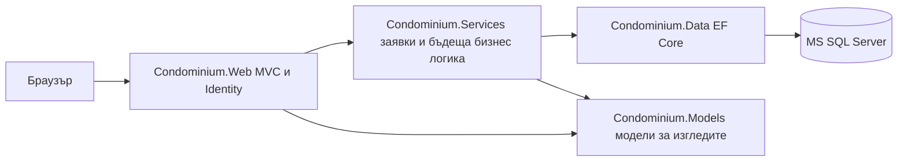

# Обща концепция за проекта

**Тема:** Система за управление на етажна собственост  
**Автор:** Кирил Димитров Ламбовски, 12В клас  
**Ръководител консултант:** Лечо Лечев  
**Етап:** първи, срок 16.11.2026 г.  
**Дата на подготовка:** 10.11.2026 г.

## Проблем и предназначение

Управлението на жилищен вход съчетава поддържане на данни за имоти и живущи, събиране на средства, отчитане на разходи и комуникация. Когато тези дейности се водят в отделни таблици и разговори, връзката между начислено задължение, получено плащане и оставаща сума се проверява ръчно. Липсва и единно място за проследяване на сигналите и взетите решения. Това е анализ на работния процес, а не резултат от проведена анкета.

Предлага се уеб приложение на български език с обща релационна база данни. То ще обслужва отделни сгради или входове. Основна единица на финансовата отчетност е апартаментът; потребителят получава достъп чрез одобрена връзка с него. Един потребител може да бъде свързан с няколко апартамента и обратно.

## Потребители и бъдещи функции

| Роля | Предназначение |
|---|---|
| Живущ — Resident | Преглежда само свързаните си апартаменти, начисления и плащания; впоследствие ще подава сигнали и ще участва в допустимите за него гласувания. |
| Домоуправител — Manager | Работи само с възложените му сгради; впоследствие ще начислява такси, отчита плащания, обработва сигнали и разходи. |
| Администратор — Administrator | Има общ преглед; в следващите етапи ще управлява сгради, тарифи, потребители и права. |

Трите роли определят техническия достъп. Ролята „Живущ“ сама по себе си не доказва собственост или представителна власт за общо събрание. Моделът пази отделно вида на връзката с апартамента и одобрението ѝ.

## Избран обхват на окончателната система

1. Регистър на сгради, апартаменти и връзки с живущи.
2. Тарифи по апартамент, по брой лица или по идеални части и месечни начисления.
3. Отчитане на частични плащания и разпределяне към най-старото задължение; остатъкът от надплащане ще остава кредит.
4. Фондове и разходи за проследимост на средствата.
5. Сигнали със статус и известия.
6. Гласувания със срок, представител на апартамента, запазена тежест на гласа и описано основание на правилата.

Изборът е обоснован в [проучването](02-research.md). Финансовите суми са `decimal(18,2)`. Предвидено е закръгляне до два знака с `MidpointRounding.AwayFromZero` при окончателното начисление; това е проектно решение, а не твърдение за универсално законово правило. Процентите идеални части са `decimal(9,6)`, в диапазона над 0 до 100. Една база обслужва множество сгради, като валутата се задава за всяка сграда; примерните данни използват EUR.

## Какво се предава на първия етап

Предават се концепцията, завършено кабинетно проучване на три решения, уводът, компилируемо многослойно ASP.NET Core MVC решение за .NET 8, Identity, моделът на данните, първа EF Core миграция и повторяемо зареждане на примерни данни. Петте предметни страници са прегледи на началните данни и служат за проверка на скелета.

На този етап не се предава завършена бизнес логика за начисляване, плащане, обработка на сигнали, гласуване или административен CRUD. Не се заявяват завършен интерфейс, внедряване, CI/CD или покритие на бизнес логиката. Съществуващият BookCatalog е запазен като предходен пример; новото решение е `Condominium.sln`.

## Технологичен скелет

Web конфигурира Identity, зависимостите и стартирането. Services съдържа заявките с ограничения за достъп. Data съдържа същностите, DbContext, миграцията и началните данни. Models съдържа моделите за преглед, без зависимост от базата данни. За следващ етап е избран Strategy за трите начина на изчисляване на таксите; реализацията му не е част от първия етап.

Последователност на разработката: проучване → начален модел и слоеве → база данни → бизнес логика → пълен интерфейс → тестове на процесите → внедряване. Настоящият пакет завършва началния модел и базата данни.

## Достъп до хранилището

Хранилище: [KiroKirkata/FinalProject](https://github.com/KiroKirkata/FinalProject). То е публично; консултантът и рецензентът могат да разглеждат и изтеглят кода без покана. По указание на възложителя засега не се добавят сътрудници. Публичният достъп за четене не предоставя права за запис.
